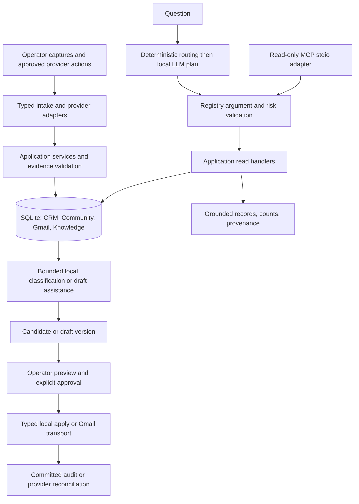

# A. Architecture and dependency assessment

Planning snapshot: 2026-10-18. Repository: `vermanthegreat/LM-STUDIO`. This package is a plan, not authorization to implement, merge, access Gmail, collect Community content, or change user databases.

## Technical verdict

The project has substantial reusable implementation, but it is not operationally complete. The shortest reliable route is to certify the existing typed planner path, integrate the contact branch with the Knowledge baseline, add the existing Community branch, and close the specific persistence, evidence, synchronization, account-isolation and communication gaps. Retain FastAPI, Pydantic, the Tool Registry, application-owned repositories and SQLite. No replacement agent framework or PostgreSQL cutover is justified by the inspected evidence.

One permitted Community workflow can be completed using operator-provided captures. An automated collector is a separate permission-dependent branch, not a prerequisite. Company/person discovery can likewise start with operator-provided company-directory, profile and website evidence and the existing bounded company-website research adapter. This satisfies the defined workflows without introducing generic browsing.

“Implemented” below means source exists. It does not mean live-certified. No tests, model requests, application HTTP requests, OAuth operations, mailbox calls or user-database queries were performed during this planning assessment.

## Evidence and limits

| ID | Evidence inspected | What it establishes |
|---|---|---|
| E01 | Current `git status`, branch listing, worktree listing and log | Primary checkout is `agent/contact-intelligence-hardening` at `816bbb0`; three actual content changes exist: `llm.py`, `services/llm_planner.py`, `tests/test_ask_llm_planner.py`. Preserve them. |
| E02 | Local remote-tracking refs, merge bases and branch diffs | `origin/main=b88bc5e`; contact branch ref `816bbb0`; Community remote-tracking ref `5acee41`. Contact/main merge base `8528eec`; Community/main merge base `b88bc5e`. No fetch was performed; these are locally observed refs, not a fresh GitHub verification. |
| E03 | Worktree listing | Community worktree is registered at `C:\Users\verman\Desktop\LM-STUDIO-community`, branch `feature/shopify-community-parser`, local HEAD `86bb246`, one commit behind its tracking ref. Its `git status` failed with `Permission denied`; cleanliness and unpublished edits are unknown. Committed Community source was inspected with `git show` from the primary repository. |
| E04 | User-supplied request and subsequent clarification | Prior audits report 233 leads, 16 people, 124 stored messages, 101 conversations and 113 recorded failures; direct model inference and stored reads worked. The third verification identifies the 8-second planner timeout and Qwen reasoning output. These counts and runtime observations were not remeasured here. |
| E05 | Report availability | User identifies `Pasted markdown(4).md` as the Claude Cloud audit and `Pasted markdown(5).md` as the Grok Local audit. Their complete contents were not available in this task's supplied attachment. Findings available through the user's summary are incorporated; unseen findings are not fabricated. T01 reconciles the reports when available to the executors. This is not a reason to stop planning. |
| E06 | Primary checkout's six required specification documents and `AGENTS.md` | SQLite is the accepted local foundation; PostgreSQL is experimental. The phase sequence in older documents does not describe all source now present. No Phase 1 certification can be inferred from the existence of later tool code. |
| E07 | Dirty planner diff, `llm.py`, `services/llm_planner.py`, `ask_router.py`, `app.py` | `/ask` uses `ask_router`, not `ask_mcp`. Dirty change raises the planner timeout from 8 to 180 seconds and requests `reasoning_effort=none`. A comment claims roughly 128 seconds on this host; this comment is not runtime evidence. The adapter accepts JSON from `message.content`, not reasoning. |
| E08 | `tools/registry.py`, `tools/read_inputs.py`, `tools/read_handlers.py`, `services/planner_validation.py`, `services/command_service.py`, `tools/envelope.py` | Typed registry, validation, result envelope and command logging exist. Contact checkout has seven read tools and two proposal tools. Main additionally registers `search_knowledge`. Planner catalog lists names/descriptions but omits argument schemas. Normal handler returns are marked succeeded even if their envelope has `status=error`; unexpected exceptions also need terminal-state tests. |
| E09 | `services/write_proposals.py`, `services/write_proposal_authority.py`, `services/write_proposal_operator.py`, related tests | Saved-proposal approval/apply/replay infrastructure exists for follow-up creation and selected company contact fields. This is reusable governance, not an existing generic person-candidate promotion or email-send capability. |
| E10 | `candidate_models.py`, `discovery_models.py`, `research_job_models.py`, `db.py`, `services/research_job_runner.py`, `services/discovery_outcome_materialization.py`, `providers/discovery_base.py`, company-website services | Noncanonical contact/person candidates, evidence rules, durable research jobs, claims/leases/recovery, bounded website discovery and materialization exist. Canonical approval/promotion and full evidence-grounded contact-method reads still require completion. |
| E11 | `providers/gmail.py`, `providers/gmail_normalize.py`, `gmail_schemas.py`, `gmail_db.py`, `services/gmail_sync_service.py`, `services/gmail_linking.py`, `gmail_runtime.py` | Read-only, single-token Gmail; full-mailbox page intake; account/message uniqueness; account/thread projections; ranked contact association and atomic token writes exist on contact branch. History API synchronization, four configured accounts and outbound transport do not. |
| E12 | `sync_gmail_full_mailbox`, `update_mailbox_sync_state`, `get_thread_messages`, email input schemas | Failed items increment a counter while the cursor advances. No durable per-message recovery queue is evident. A final page can be marked completed despite failures. Cumulative counts are added on each page update, risking overcount for multiple pages in one call. Thread account is optional; list-email tool lacks an account filter. |
| E13 | `origin/main` Knowledge files and tests; main roadmap G2 section | K0 ingestion, K1 embeddings/hybrid search and a typed Knowledge read tool exist on main, not this contact checkout. G2 already specifies four accounts, full/history sync, MIME, attachments, provider drafts, approved sending, reconciliation, failure recovery and fake-provider coverage. Reuse it. |
| E14 | `origin/feature/shopify-community-parser` at `5acee41`: `docs/community.md`, schemas, parser, database, services and tests | Topic/discovery/user-summary capture, revisions, reply references, coverage states and a resumable derived queue exist. Compatibility is explicitly synthetic-only. “Rendered text” means the project's structured capture format, not arbitrary native page copy. No collector, Community LLM classifier, CRM link or MCP transport exists in these modules. |
| E15 | Community ingest/discovery logging and database initialization | Community data commits before best-effort audit logging; a successful ingest may have no command ID. Duplicate handling can return without a new command record. `ensure_community_tables` uses `executescript`, including in read paths; schema setup must be removed from operational transactions and MCP reads. |
| E16 | `ask_mcp.py`, requirements, application imports | `ask_mcp.py` is a legacy PostgreSQL “MCP-style” internal tool loop, not a protocol MCP server. It is not the active `/ask` route. Wrapping it would duplicate and bypass the accepted registry path. |
| E17 | `tests/test_query_counts.py`, main test-isolation commit `7c8f47b`, Python launcher inventory | Contact tests still contain fallback calls without a database path; main's isolation correction must survive integration. `py -0p` lists Python 3.10.11 only. Python 3.11+ is required by AGENTS. This does not prove no other interpreter is installed. No suite result is claimed. |

Primary source links: [planner](<C:/Users/verman/Desktop/LM STUDIO/services/llm_planner.py>), [active router](<C:/Users/verman/Desktop/LM STUDIO/ask_router.py>), [registry](<C:/Users/verman/Desktop/LM STUDIO/tools/registry.py>), [Gmail sync](<C:/Users/verman/Desktop/LM STUDIO/services/gmail_sync_service.py>), [Gmail persistence](<C:/Users/verman/Desktop/LM STUDIO/gmail_db.py>), [candidate validation](<C:/Users/verman/Desktop/LM STUDIO/candidate_models.py>), [SQLite repository](<C:/Users/verman/Desktop/LM STUDIO/repositories/sqlite_store.py>).

For branch-only evidence use `git show <ref>:<path>`; opening a same-named working-tree file does not establish that branch's behavior. The plan contains proposed file names explicitly marked NEW; they are not evidence of existing implementation.

## Reuse and unavoidable work

| Area | Reuse | Remaining work |
|---|---|---|
| Planner | One typed plan, Pydantic validation, deterministic routes and grounded presentation | Verify actual Qwen request behavior, bounded timeout/token budget, argument schemas, explicit failure attribution, terminal command states and a real non-deterministic tool selection. |
| Contact intelligence | Existing intake/parsers, exact identity tiers, candidates, research jobs and governed proposals | Evidence-preserving candidate promotion; canonical contact-method evidence where legacy scalar fields lose it; conservative Community/company/person association; email-to-task bridge. |
| Community | Existing capture parser/storage/discovery/coverage queue | Genuine captures, demonstrated parser corrections, audit atomicity, read tools, versioned classification/pain points, CRM evidence links. |
| Knowledge | Main's K0/K1 and `knowledge.tool` | Preserve through integration. Reuse bounded local-model/evidence patterns; do not copy Community posts into Knowledge as a second authoritative store. No new vector subsystem required. |
| MCP | Registry specs, read handlers, schemas, envelope and repository interfaces | Thin stdio server with a read-only allowlist and tested client compatibility. No new planner or provider credentials. |
| Gmail | Existing read-only adapter, normalization, local evidence, links and full-page intake | Recover lost/failed items, correct counts/checkpoints, history convergence, MIME/attachments, account configuration and end-to-end isolation, drafts/send reconciliation. |
| Local operations | Loopback/Origin protection, configurable paths, transaction and research recovery primitives | Verified Python runtime, explicit additive migrations, backup/restore rehearsal, restart and final operator runbook. |

## Target boundaries

MCP exposes reads of stored data, never arbitrary SQL, files, URLs, provider sync, draft writes, approval, apply or send. A model can select a read, suggest a candidate or generate draft text; these are distinct from executing tools, promoting facts or authorizing a message. Stdio avoids introducing another network listener. A local model uses the existing planner path; an MCP-capable client uses the adapter. Both share handlers; LM Studio being an inference server does not by itself prove it consumes MCP.

Keep user payloads, OAuth credentials and message bodies out of ordinary logs. Gmail send uses one reviewed account/draft/version/recipient/attachment snapshot. A provider timeout can leave delivery unknown; the plan requires an `unknown` state and reconciliation before retry, not a promise that a local idempotency key makes a remote send transactional.

## Phase and specification reconciliation

The active supported baseline remains SQLite Phase 0, with in-tree typed-query/controlled-write/contact and G0/G1 functionality subject to regression certification. Main adds K0/K1 and the G2 specification; Community adds CI M0/M2 with M1 compatibility pending. Planning these extensions does not accept PostgreSQL Phase 1 or waive existing phase gates.

T03 must make a narrow later SQLite completion specification authoritative before extension code: stored-data MCP and Community read/classification/association, governed candidate promotion, email follow-up proposals and local LLM-assisted drafting. This resolves Community's blanket MCP prohibition and G2's exclusion of AI drafting. Retain prohibition of automated collection unless permission evidence and a fixed collector scope are separately approved. Retain no autonomous sending and no Calendar/product expansion.

No completion percentage or calendar estimate is justified while planner behavior, genuine capture compatibility, message failure causes and account access remain unverified. Use the ordered gates and evidence packages in this plan instead.
