# B. Master execution plan

Read [assessment](A-assessment.md), [task backlog](C-task-backlog.md), [agent instructions](D-agent-instructions.md) and [certification matrix](E-acceptance.md). Task IDs are stable across all five deliverables. No implementation is performed by this package.

## Dependency graph

```mermaid
flowchart TD
 T01[T01 Evidence and preservation] --> T02[T02 Isolated Python baseline]
 T01 --> T03[T03 Completion specification]
 T02 --> T04[T04 Planner correction]
 T04 --> T05[T05 Local planner E2E: Gate 1]
 T05 --> T06[T06 Main plus contact integration]
 T03 --> T06
 T06 --> T07[T07 Community branch integration]
 T07 --> T08[T08 Migration and regression: Gate 2]
 T08 --> T09[T09 Human genuine captures]
 T09 --> T10[T10 Parser corrections]
 T10 --> T11[T11 Community transaction and audit]
 T11 --> T12[T12 Real persistence: Gate 3]
 T12 --> T13[T13 Community read tools]
 T13 --> T14[T14 Community classification and pain points]
 T14 --> T15[T15 Read-only MCP adapter]
 T15 --> T16[T16 Retrieval and MCP: Gate 4]
 T16 --> T17[T17 Contact promotion and evidence]
 T17 --> T18[T18 Community to CRM association]
 T18 --> T19[T19 Contact workflow: Gate 5]
 T08 --> T20[T20 Local Gmail failure diagnosis]
 T19 --> T21[T21 Recoverable full synchronization]
 T20 --> T21
 T21 --> T22[T22 History and mailbox convergence]
 T22 --> T23[T23 MIME and attachment completeness]
 T23 --> T24[T24 Full sync live verification: Gate 6]
 T24 --> T25[T25 Four-account configuration and isolation]
 T25 --> T26[T26 Four-account live verification: Gate 7]
 T26 --> T27[T27 Durable provider drafts]
 T27 --> T28[T28 Approved send and reconciliation]
 T28 --> T29[T29 Local LLM drafting and follow-up proposals]
 T29 --> T30[T30 Controlled communication: Gate 8]
 T30 --> T31[T31 Cross-system certification: Gate 9]
 T31 --> T32[T32 Recovery and operations: Gate 10]
```

This graph deliberately defines a sequential execution lane. T20 can run after Gate 2 while Community work proceeds, but no parallel agents or duplicate edits are required. T15's adapter depends technically on T13 and the integrated registry; it follows T14 here so Gate 4 certifies the intended classified retrieval surface once. T17's contact changes reuse code already integrated at Gate 2. Neither Gmail transport nor automated Community access is required for the first planner and stored-data E2Es.

## Milestones

| Milestone | Tasks, in execution order | Measurable exit |
|---|---|---|
| M0: preserve and freeze scope | T01 → T02; T03 | Evidence manifest records exact refs/dirty paths, a restorable backup procedure exists, Python 3.11+ isolated baseline is trustworthy, and the narrow completion specification resolves conflicting scope. |
| M1: prove local intelligence | T04 → T05 | Gate 1: a real Qwen-selected registered read executes against known stored data with correct arguments/results/audit and bounded latency. Mocked selection or deterministic routing alone fails. |
| M2: integrate existing work | T06 → T07 → T08 | Gate 2: staged main/contact then Community integration passes the combined isolated suite and copy-based migration/reconciliation. No user data or dirty worktree overwritten. |
| M3: prove real Community intake | T09 → T10 → T11 → T12 | Gate 3: genuine listing/summary/topic evidence persists, replay is idempotent, partial coverage is truthful, revision and audit failure injection behaves atomically. |
| M4: retrieve and classify | T13 → T14 → T15 → T16 | Gate 4: stored Community reads and versioned pain points work through `/ask` and a real MCP client; provenance is traceable and no write/provider tool is exposed. |
| M5: connect contact intelligence | T17 → T18 → T19 | Gate 5: one real company/person/contact evidence chain is reviewed and committed once, linked to a genuine discussion, communication evidence and research/follow-up state; ambiguous identities remain candidates. |
| M6: reliable Gmail ingestion | T20 → T21 → T22 → T23 → T24 | Gate 6: the historical failure tally is explained, failed items are recovered or individually accounted for, full/history ingestion reconciles provider scope, replay and restart have no gaps, MIME evidence is usable. |
| M7: four accounts | T25 → T26 | Gate 7: four separately authorized accounts work; identical provider IDs cannot leak/collide; failure or revocation of one account leaves the others operational. |
| M8: governed communication | T27 → T28 → T29 → T30 | Gate 8: local-model draft assistance, durable Gmail draft, explicit version-bound send, provider readback and governed follow-up task each have distinct evidence; duplicate/unknown outcomes are safe. |
| M9: cross-system proof | T31 | Gate 9: A/B/C run together on one certified commit, preserving source links and account boundaries. |
| M10: local acceptance | T32 | Gate 10: restart, restore, integrity, secrets/logging, operating instructions and all previous evidence pass; HUMAN records final acceptance. |

## Integration sequence and conflict policy

1. **Preserve first.** T01 inventories the dirty planner patch and both worktrees. Do not switch, reset, stash or merge the primary checkout. The executor later creates a separate `codex/finalization-integration` branch in an authorized checkout from verified `origin/main`. Re-fetch only during a future authorized integration task, record new SHAs and re-evaluate if they differ.
2. **Prove and preserve the planner fix independently.** T04/T05 certify the actual local patch. Export/review its exact diff; carry it as a separate commit or patch into the integration branch after the contact merge. Do not assume its uncommitted presence makes it part of `816bbb0`.
3. **Merge contact into main first.** Main has K0/K1 and G2 scope; contact has larger CRM/research/Gmail changes. A merge preserves contact history and avoids guessing which of its many commits are dispensable. Review the complete diff, not just `ecd9a29`/`816bbb0`. The concrete overlap since `8528eec` includes `.gitignore`, `README.md`, `app.py`, `ask_router.py`, `config.py`, `db.py`, `docs/tool-contracts.md`, `static/app.css`, six shared templates and `tests/test_query_counts.py`. Actual conflicts remain unverified until a disposable integration attempt; no merge was simulated here.
4. **Resolve semantically.** Retain all active routes, Knowledge registration, enhanced Gmail/contact handlers, configuration fields, structured response counts and the main test-isolation correction. Never select an entire side of `app.py`, `db.py` or templates just to clear conflicts. Do not route `/ask` into legacy `ask_mcp.py`.
5. **Integrate Community second.** Its three commits are `c4e4d85`, `86bb246`, `5acee41`, based on `b88bc5e`. Most modules are additive; shared surfaces include `AGENTS.md`, `app.py`, `db.py`, roadmap/product/docs index and navigation templates. Integrate the committed remote tip, not the stale local worktree by assumption. Preserve its authorization prohibitions until the explicit T03 extension applies.
6. **Schema ordering.** Keep existing Alembic `001`–`004` unchanged; they do not certify PostgreSQL. Rehearse current additive SQLite initializers on a consistent backup copy: core/contact/research + Gmail, then Knowledge, then Community. Inventory startup/read-time DDL first. Add a small explicit versioned SQLite migration runner for new completion schemas; no schema creation inside a data transaction or MCP read. Future additions follow dependencies: analysis → canonical contact evidence/links → failed-item and mailbox state → account scope → drafts/send attempts/task provenance. Each version has upgrade/rollback-or-restore evidence and leaves older source rows intact.
7. **Gate every integration.** Run targeted tests after each resolved component, the full combined suite after each integration stage, then startup/reconciliation on a disposable backup copy. Main promotion happens only with Gate 2 evidence, reviewed diff and no unresolved gate. Subsequent milestone commits remain small and independently testable.

## What is not a completion dependency

PostgreSQL cutover; a new orchestration framework; vector redesign; Calendar; campaigns; SaaS; arbitrary external company search; autonomous research or sending; arbitrary browser automation; Community posting/replies; the unmerged vision reanalysis branch `949df02`. Preserve existing K0/K1 behavior, but a new Knowledge feature is not required.

Automated Community collection is a conditional extension only: HUMAN records permitted surfaces, source terms/access evidence, account conditions, retention/rate limits and explicit authorization. Only then define a separate fixed typed collector task feeding the existing capture/discovery contracts and test it. If permission remains unresolved, record **AUTOMATED COLLECTION NOT AUTHORIZED** and certify operator capture as the selected E2E A path. Do not quietly imply an automated collector exists.
